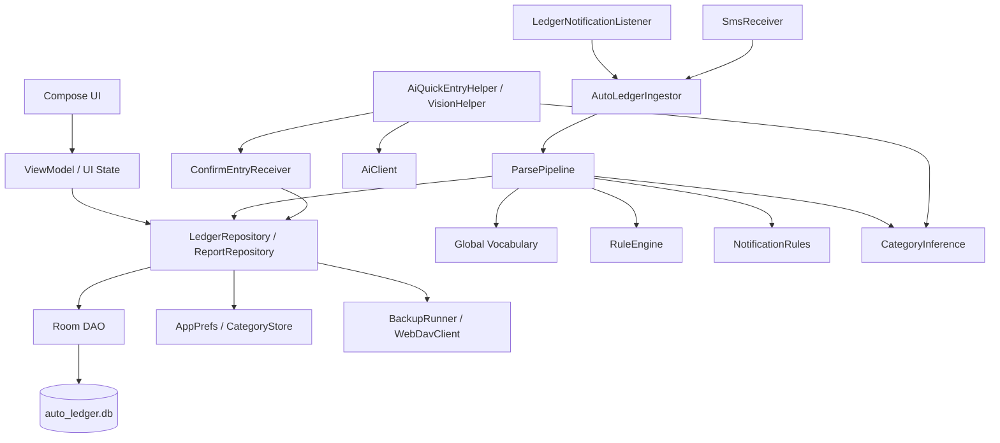

# 系统架构

## 1. 架构概览

AutoLedger 采用单模块 Android 应用架构。Compose 页面通过 ViewModel、Repository 和偏好单例访问数据，系统入口统一进入解析与入库链路。

## 2. 分层职责

| 层 | 主要文件 | 职责 |
| --- | --- | --- |
| 入口层 | `MainActivity.kt` | 初始化加密存储、后台任务、通知权限和三页签根界面 |
| UI | `ui/`、`settings/` | Compose 页面、主题、设置页和交互状态 |
| 状态 | `viewmodel/HomeViewModel.kt` | 首页分页、汇总与小部件数据 |
| 编排 | `service/AutoLedgerIngestor.kt` | 短信与通知的统一自动入账用例 |
| 解析 | `data/ParsePipeline.kt`、`RuleEngine.kt`、`NotificationRules.kt` | 规则优先级、金额与方向解析、兜底 |
| AI | `network/`、`screenshot/` | 请求、Prompt、JSON 清洗、识图和确认 |
| 领域规则 | `CategoryInference.kt`、`ParseDedup.kt`、`TransferPairMatcher.kt` | 分类、跨源合并、转账配对 |
| 仓库 | `LedgerRepository.kt`、`ReportRepository.kt`、`BackupRunner.kt` | 写入、查询、报表和备份编排 |
| 存储 | `LedgerDatabase.kt`、`LedgerDao.kt`、`AppPrefs.kt` | Room、SharedPreferences 与加密偏好 |
| 系统集成 | `service/`、`reminder/`、`widget/`、`tile/` | 广播、任务、提醒、小部件和磁贴 |

## 3. 启动链路

`MainActivity.onCreate()` 按顺序执行：

1. `SecurePrefs.warmUp()` 后台预热 Keystore 加密存储。
2. `HealthJobService.schedule()` 调度 15 分钟后台心跳。
3. `BackupJobService.schedule()` 调度 WebDAV 自动备份检查。
4. `ReminderScheduler.rescheduleAll()` 重建每日、每周和每月提醒。
5. `RecurringWorker.schedule()` 与 `runNow()` 安排并补跑周期账单。
6. 请求 Android 13+ 通知权限。
7. `AppRoot ` -> `LedgerApp ` 创建主题、三页签和全局 Snackbar。

后台任务调度均为幂等操作，重复冷启动不会叠加多条同类任务。

## 4. 主界面与覆盖层

`LedgerApp.kt` 维护：

- 三个主页面：首页、记一笔、报表。
- 设置页覆盖层：`SettingsScreen`。
- 搜索页覆盖层：`SearchScreen`。
- AI 操作面板：拍照、相册、文本 AI。
- 全局 Snackbar。
- 自定义背景图与主题。

Back 键规则：

- 设置页优先返回父级设置页。
- 搜索页关闭覆盖层。
- “记一笔”回到首页。
- 主界面保持在首页。

## 5. 自动记账数据流

### 5.1 通知

`LedgerNotificationListener` 读取通知标题、正文和大文本，提取包名、时间和通知 Key，再交给 `AutoLedgerIngestor.process(..., NOTIFICATION)`。

### 5.2 短信

`SmsReceiver` 接收 `SMS_RECEIVED`，规范化和拼接长短信后交给 `AutoLedgerIngestor.process(..., SMS)`。

### 5.3 统一入库

`AutoLedgerIngestor` 负责：

1. 规范化原文并生成内存与持久化去重键。
2. 调用 `ParsePipeline`。
3. 判断 `autoRecord`。
4. 调用 `LedgerRepository.addAutoParsed()`。
5. 更新时间戳并调用 `BillNotifier` 发出可撤销通知。

## 6. AI 数据流

### 6.1 文本

`AiQuickEntryDialog` -> `AiQuickEntryHelper` -> `AiPrompt` -> `AiClient` -> JSON 清洗 -> 本地校验 -> 回填 `AddScreen`。

文本 AI 不直接入库，用户确认表单后才正常保存。

### 6.2 识图

图片入口 -> 图片缩放/截屏 -> `VisionHelper.callVisionModel()` -> `AiClient` -> 多笔解析 -> `CategoryInference` -> `VisionHelper.postResult()` -> 用户确认 -> `ConfirmEntryReceiver` -> `LedgerRepository.addAll()`。

截图来源有三种：

- 无障碍 `takeScreenshot()`。
- MediaProjection 授权截图。
- 相册或拍照上传。

## 7. 数据写入约束

- 所有账单写入通过 `LedgerRepository`。
- 所有周期模板和报表聚合通过 DAO 查询，不直接读 Room 文件。
- `AppPrefs` 是普通配置和敏感配置的唯一入口。
- `CategoryStore` 是一级/二级分类定义的唯一入口。
- 自动解析写入口使用 `autoParsedMutex`，转账状态变更使用 `transferMutex`。
- `autoParsedMutex -> transferMutex` 保持固定锁顺序。

## 8. 后台任务

| 任务 | 调度者 | 周期/触发 | 作用 |
| --- | --- | --- | --- |
| `HealthJobService` | JobScheduler | 约 15 分钟 | 尝试恢复权限、复检通知使用权、清理去重键 |
| `BackupJobService` | JobScheduler | 定时 | 满足 20 小时间隔后自动 WebDAV 备份 |
| `RecurringWorker` | WorkManager | 每日 00:05 附近 | 生成当天周期账单 |
| `ReminderScheduler` | AlarmManager | 每日/每周/每月 | 记账提醒和报表提醒 |
| `ReminderBootReceiver` | 系统广播 | 开机/更新 | 重建被系统清空的提醒 |
| `PackageReplacedReceiver` | 系统广播 | 覆盖安装 | 立即复检通知使用权 |

## 9. 可选系统增强

### 9.1 ADB / Shizuku 自愈

用户手工授予 `WRITE_SECURE_SETTINGS` 后，`SystemAccess.ensureGrants()` 可尝试写回通知使用权与无障碍服务。没有权限时只做只读检查。

### 9.2 LSPosed

`xposed/LedgerModule.kt` 已声明为 system scope 模块，并在 system_server 启动时写日志。当前没有 Hook 业务逻辑，核心记账不依赖 Root。

## 10. 架构约束

- 页面不得直接访问 DAO。
- 网络请求不得在 Compose 主线程执行。
- 自动解析不得绕过全局词库。
- 规则预览必须调用 `RuleEngine.previewRule()`。
- 分类词库不得在多个文件复制。
- 金额比较和指纹必须换算为分。
- 新增数据库字段必须提供迁移与迁移单测。
- 新增 UI 颜色、字号、间距必须从设计 Token 读取。
